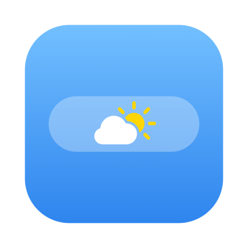
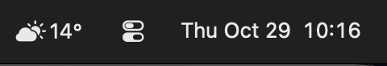

<p align="center">
  
</p>

<h1 align="center">macOS weather bar</h1>

<p align="center">
  A tiny menu bar app that shows the current temperature in Celsius and a weather icon for where you are. No settings, no windows, no account.
</p>

<p align="center">
  
</p>

## Features

- Current temperature in °C with a native SF Symbols weather icon
- Location from macOS Location Services
- Weather from [Open-Meteo](https://open-meteo.com), no API key needed
- Refreshes every 15 minutes and on wake
- Click the icon for a single menu item: Quit

## Build

Requires Xcode command line tools.

```sh
./build.sh
```

This builds the app, installs it to `/Applications/WeatherBar.app` and launches it. Allow location access when asked. To start it at login, add it under System Settings › General › Login Items.
